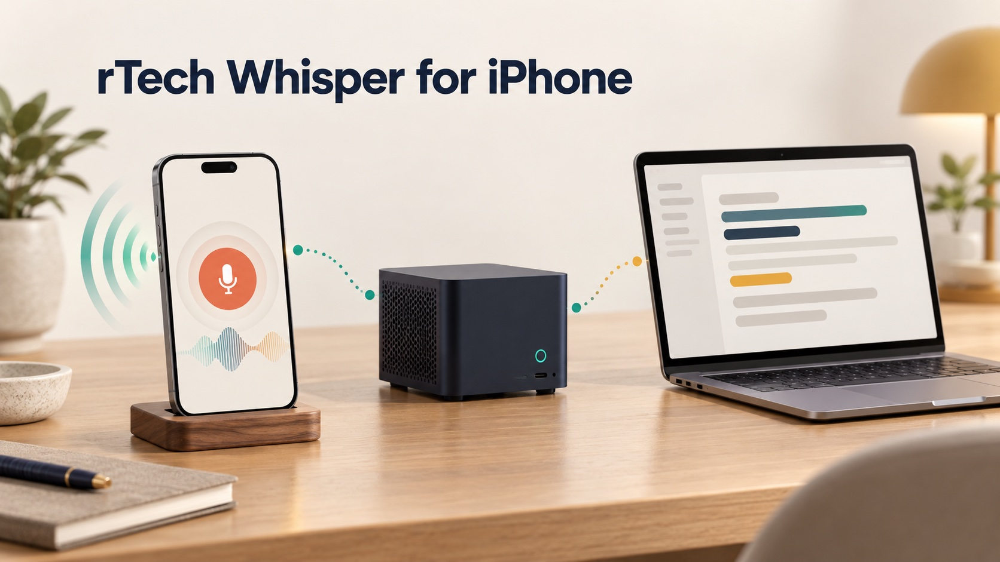
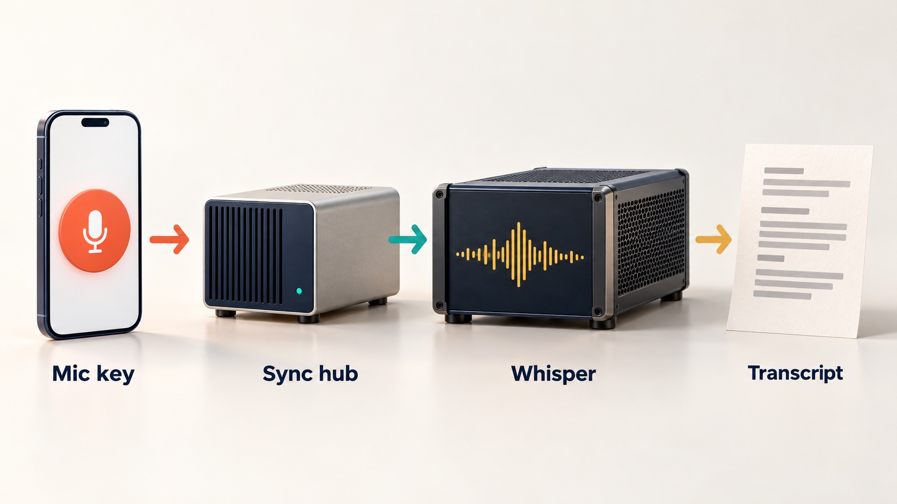
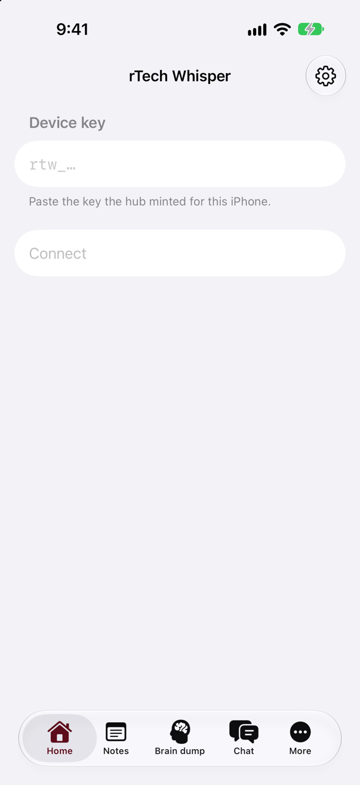

# rTech Whisper for iPhone

A native SwiftUI dictation app for iPhone that sends your voice to your own
speech-to-text server and keeps notes, history and snippets in sync with the
desktop app.

[](LICENSE)




## What it is

rTech Whisper for iPhone is the phone half of rTech Whisper, a self-hosted
dictation setup. The desktop side is a fork of
[OpenWhispr](https://github.com/OpenWhispr/openwhispr)
([rodaddy/openwhispr](https://github.com/rodaddy/openwhispr)). The server both
apps talk to is [rtech-whisper-hub](https://github.com/rodaddy/rtech-whisper-hub).
This app shares no code with the desktop app: all of it was written for iOS.
It is about 28,000 lines of Swift across the app, a keyboard extension, a
widget extension and the `RtechWhisperKit` package.

## Why it exists

Dictation that runs on your own Whisper server is easy to set up on a desktop
and hard to carry onto a phone. This app brings the same habit to the iPhone:
record, get the text back from your own server, and find it on the desktop
too, without sending audio to a public speech API.

## How it works



Every network call goes to one hub, named at build time (`RTW_HUB_BASE_URL`),
and authenticated with a device key the hub mints for the phone. A recording is
encoded as 16 kHz WAV and sent to the hub's speech relay, which forwards it to
a Whisper-compatible server. If the hub cannot be reached, the take is
transcribed on the phone with Apple's on-device speech recognition and shown at
once; the Whisper text replaces it later unless you edited it. Notes, folders,
dictionary words and snippets live in SwiftData on the phone and sync with the
hub through a pull/push engine with cursors and conflict handling
(`Sync/`), using the same protocol the desktop app speaks
([docs/desktop-sync-protocol.md](docs/desktop-sync-protocol.md)). Chat talks to
an LLM behind the hub with tool calls that can read and edit notes. The logic
lives in `Packages/RtechWhisperKit`; the `App/`, `Keyboard/` and `Widgets/`
targets are thin.



*Real screenshot: the first-launch screen, built from this repo and run in the
iOS simulator with no hub configured.*

## Features

- Dictate through your own hub, with an offline queue and on-device speech as
  the backup when the hub is unreachable.
- Keyboard extension with a mic key that hands off to the app and offers the
  transcript back as an Insert key in the field you were typing in.
- Live Activity in the Dynamic Island and on the Lock Screen while recording
  (recording, transcribing, result), with a Stop button.
- Control Center control and Shortcuts intents to start dictation or open a
  brain dump.
- Notes with folders, search, a conflict banner and AI note actions; history
  with retention settings; dictionary words fed to transcription; spoken
  snippets that expand to saved text.
- File upload that cuts long audio into chunks at silence and resumes after a
  relaunch.
- Chat with an LLM behind the hub, with tool calls over your notes and replies
  optionally read aloud by the hub's speech server.

## Quick start

Requires Xcode with the iOS 27 SDK and
[XcodeGen](https://github.com/yonaskolb/XcodeGen). Running on a device needs
an Apple Developer account; the simulator does not.

```bash
git clone https://github.com/rodaddy/rtech-whisper-ios.git
cd rtech-whisper-ios
scripts/bootstrap.sh                                  # generates RtechWhisper.xcodeproj from project.yml
swift test --package-path Packages/RtechWhisperKit    # the package tests, no simulator needed
```

Build for the simulator:

```bash
xcodebuild -project RtechWhisper.xcodeproj -scheme RtechWhisper \
  -destination 'platform=iOS Simulator,name=iPhone 18 Pro' \
  CODE_SIGNING_ALLOWED=NO RTW_HUB_BASE_URL=https://hub.example.com build
```

For a device, open `RtechWhisper.xcodeproj`, set your team on each target (or
fill `DEVELOPMENT_TEAM` in `project.yml` and rerun the bootstrap), set
`RTW_HUB_BASE_URL` to your hub's URL, and change the bundle ID and app group
(`com.rtech-consulting.whisper`, `group.com.rtech-consulting.whisper`) to ones
your team owns. `project.yml` is the source of truth; the generated Xcode
project is never committed.

What it does not include: no App Store or TestFlight build, no hub, speech
server or LLM (see [rtech-whisper-hub](https://github.com/rodaddy/rtech-whisper-hub)),
and no iPad or Mac layout. It does not use the upstream OpenWhispr cloud.

## How it was built

The app went from an empty repository to a working phone client in two days
(2026-09-29 and 2026-09-30), built by AI coding agents working in parallel
lanes under one controller and checked by a two-model review loop. The
phases, design decisions, review process and what changed along the way are in
[docs/BUILD-STORY.md](docs/BUILD-STORY.md).

## Project status

Experimental, version 0.1.0. It runs from development builds on the author's
own iPhone against his own hub. Other devices, other hub deployments and
multi-user use are not proven. This public repository is an export of the
2026-10-13 state; the package's 675 tests pass on it.

## Credits

- [OpenWhispr](https://github.com/OpenWhispr/openwhispr), the desktop
  dictation app whose sync model this app follows.
- [XcodeGen](https://github.com/yonaskolb/XcodeGen) for the project file.

## Licence

MIT. See [LICENSE](LICENSE).

## Author

Rico Rojas, https://rico-rojas.com
